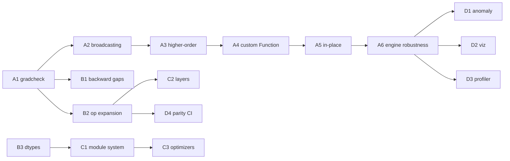

# PyTorch / libtorch Parity Roadmap

Status: **draft** · Branch: `parity/pytorch-roadmap` · Last updated: 2026-10-29

This is a staged plan to move `dart_pytorch` from a hand-curated ~1 % slice of
PyTorch toward a general-purpose differentiable tensor library. It is scoped
across four tracks:

- **A. Autograd engine** — higher-order grad, custom `Function`, in-place
  tracking, full broadcasting, `gradcheck`.
- **B. Op / kernel coverage** — close the differentiable op surface, GPU
  backward parity, dtypes.
- **C. nn.Module / training API** — layer, optimizer, scheduler, and
  serialization ergonomics.
- **D. Ecosystem / tooling** — profiler, graph viz, anomaly detection.

Full libtorch parity is explicitly **not** the goal — the target is "a faithful
and general autograd core plus the op/layer surface real models need," not
2000+ ATen ops. Each phase is independently shippable and gated by tests.

---

## Where we are today (baseline)

Grounded in the current `lib/core/tensor` implementation:

| Capability | Today |
| --- | --- |
| Reverse-mode tape | ✅ define-by-run, `_setBackward(children, fn)`, reverse-topo `backward()` |
| Leaf semantics | ✅ `requiresGrad`, `.grad`, `zeroGrad()`, `detach()`, `noGrad()` |
| Grad accumulation | ✅ `_accumulateGrad` + `_reduceForBroadcast` |
| CPU/GPU parity | ✅ backward composed from forward ops; FFI CUDA kernels |
| Op surface | ⚠️ ~25 ops (`+ - * /`, matmul, `relu/sigmoid/tanh/abs/log/pow`, `transpose/reshape`, `sum/mean`, softmax, LayerNorm, RMSNorm, crossEntropy, embedding, attention, concat, dropout, scatter, AFT) |
| Higher-order grad | ❌ no `create_graph` / `grad()`; backwards not themselves differentiable |
| Broadcasting | 🟡 full NumPy broadcasting on CPU (fwd + backward reduce); GPU still scalar/row only |
| In-place autograd | ❌ not tracked |
| Custom autograd API | ❌ edit the op file by hand |
| `relu`/`abs` backward | ⚠️ CPU-only |
| conv / hopfield | ⚠️ bypass the tape |
| gradcheck / tooling | 🟡 CPU harness landed (`test/gradcheck.dart`); GPU + anomaly pending |

Test coverage already includes `test/autograd_test.dart` plus ~100 model/op
tests — a strong regression net to build on.

---

## Track A — Autograd engine parity

### A1. Numerical `gradcheck` harness  _(foundation — do first)_  🟡 in progress
- ✅ Added `test/gradcheck.dart`: central finite-difference vs analytic `.grad`
  with `gradCheck` / `expectGradCheck`, per-input tolerance.
- ✅ `test/gradcheck_test.dart` covers the CPU op surface (binary, unary,
  reshape/transpose, sum/mean, matmul, softmax, layerNorm, rmsNorm,
  crossEntropy, embedding, concat) — 23 ops passing.
- ⬜ Parametrize the same checks on GPU (`Device.GPU`) behind a CUDA guard.
- ⬜ Add remaining ops as they land (dropout eval-mode, scatter, AFT).
- **Exit:** all current ops pass gradcheck within tolerance on CPU **and** GPU;
  becomes the gate for every new op in Track B.

### A2. Full broadcasting in autograd  🟡 CPU done
- ✅ Generalized `_reduceForBroadcast` to full NumPy/PyTorch rules (sum out
  every expanded axis, incl. missing leading dims).
- ✅ `_binaryCpu` now broadcasts arbitrary rank operands via strides;
  shared helpers `_broadcastShapes` / `_padShape` / `_rowMajorStrides`.
- ✅ gradcheck covers row, column, leading-dim, and 3D×2D broadcasts.
- ⬜ GPU broadcast kernels (currently scalar + row-broadcast on `+` only);
  until then non-trivial GPU broadcasts throw a clear error.
- **Exit:** `a + b` etc. match `torch` broadcasting on a shape matrix;
  gradcheck passes for broadcasted operands (CPU ✅, GPU pending).

### A3. Higher-order gradients
- Make backward closures build graph nodes when a `create_graph` flag is set
  (backward of each op expressed via differentiable ops, already mostly true).
- Add `Tensor.grad(outputs, inputs, {createGraph})` analogous to
  `torch.autograd.grad`, returning grads without mutating `.grad`.
- Keep `backward(freeGraph: false)` working for the inspect case.
- **Exit:** second-order gradcheck (grad-of-grad) passes for a core subset
  (`*`, matmul, `tanh`, `sum`, softmax).

### A4. Custom autograd `Function` API
- Public `abstract class AutogradFunction { forward(ctx, inputs); backward(ctx, gradOut); }`
  with a `ctx.saveForBackward(...)`.
- Reimplement one existing fused op (e.g. AFT or crossEntropy) on top of it as
  the reference/dogfood.
- **Exit:** user-defined op participates in `backward()` and passes gradcheck.

### A5. In-place op tracking
- Version counter per tensor; backward asserts no saved tensor was mutated
  after use (PyTorch's "modified by an inplace operation" guard).
- Add a minimal set of safe in-place ops (`add_`, `mul_`, `zero_`).
- **Exit:** in-place misuse raises a clear error; valid in-place passes
  gradcheck.

### A6. Engine robustness
- Replace recursive `visit()` with an explicit worklist to avoid stack
  overflow on deep graphs.
- Add backward **hooks** (`registerHook`) and optional **anomaly detection**
  (NaN/Inf origin tracking) — feeds Track D.
- **Exit:** 10k-node chain backprops without overflow; hook fires.

---

## Track B — Op / kernel coverage parity

### B1. Close CPU/GPU backward gaps
- Port `relu` / `abs` backward to GPU (currently CPU-only).
- Wire conv1d/conv2d/conv-transpose and hopfield into the tape (or document
  as intentionally detached + provide a differentiable path).
- **Exit:** no op silently drops gradients; gradcheck on GPU for the full set.

### B2. Core math op expansion
- Unary: `exp`, `sqrt`, `rsqrt`, `neg`, `reciprocal`, `clamp`, `sin`, `cos`,
  `silu`, `gelu` (exact + tanh), `softplus`, `erf`.
- Reductions: `sum(axis, keepDim)`, `mean(axis)`, `max/min(axis)`, `var/std`,
  `prod`, `logsumexp`.
- Shape: `permute`, `view`/`flatten`, `squeeze`/`unsqueeze`, `cat(axis)`,
  `stack`, `split`, `slice`/`narrow`, `gather`, `index_select`.
- **Exit:** each lands with a gradcheck test (A1 gate) and GPU kernel or
  documented CPU fallback.

### B3. Dtype breadth
- Promote fp16 from "read-only for autograd" to trainable (fp32 master,
  fp16 storage) — groundwork for mixed precision.
- Add bf16 storage; integer tensors for indexing ops.
- **Exit:** a small model trains in mixed precision and matches fp32 within
  tolerance.

### B4. Linear-algebra & fused kernels
- `bmm`/batched matmul with autograd, `einsum` (subset), fused SDPA backward.
- **Exit:** batched attention path uses batched kernels; gradcheck passes.

---

## Track C — nn.Module / training API parity

### C1. Module system ergonomics
- Formalize `parameters()` / `namedParameters()` / `buffers()`,
  `state_dict()` / `load_state_dict()` on top of existing `Checkpoint`.
- `apply()`, `to(device/dtype)`, `train()/eval()` already partly present —
  unify across all modules.
- **Exit:** round-trip `state_dict` for every bundled model; device/dtype
  move is uniform.

### C2. Layer coverage
- Fill gaps vs `torch.nn`: `Conv2d`/`ConvTranspose` as first-class
  autograd modules, `BatchNorm`/`GroupNorm`, `MaxPool/AvgPool`,
  `GELU/SiLU` modules, `GRU/LSTM` (an `LSTMCell` already exists).
- **Exit:** a small CNN + an RNN train end-to-end via the tape.

### C3. Optimizers & schedulers
- Add `AdamW`, `RMSprop`, `Adagrad` alongside `SGD`/`Adam`; param groups with
  per-group lr/weight-decay.
- Schedulers: `CosineAnnealing`, `OneCycle`, `ReduceLROnPlateau` (have
  `StepLR`, `LinearWarmupCosineDecay`).
- **Exit:** param-group config drives different lr per layer; schedulers unit
  tested.

### C4. Losses & functional API
- `nn.functional`-style free functions (`mse_loss`, `nll_loss`, `bce`,
  `kl_div`, `cross_entropy` with weight/ignore_index).
- **Exit:** each loss gradchecks and has a parity test against known values.

---

## Track D — Ecosystem / tooling parity

### D1. Autograd anomaly detection
- NaN/Inf detection with the op that produced it (builds on A6 hooks).

### D2. Graph export / visualization
- `toDot()` graph dump (torchviz-style) for debugging the tape.

### D3. Lightweight profiler
- Per-op forward/backward timing + device, CPU and CUDA, aggregated report.

### D4. Benchmarks & parity CI
- Golden numerical parity tests against exported PyTorch reference tensors for
  a fixed op/model set; track drift in CI.

---

## Suggested sequencing

**Milestone 1 (unblock everything):** A1 + A2 + B1 — a trustworthy,
broadcasting, gap-free autograd with a gradcheck gate.

**Milestone 2 (differentiable-programming core):** A3 + A4 + B2 — higher-order
grad, a public custom-op API, and a real op surface.

**Milestone 3 (training parity):** A5 + A6 + C1–C4 + B3 — in-place safety, a
robust engine, and a PyTorch-shaped nn/optim/loss layer with mixed precision.

**Milestone 4 (ecosystem):** D1–D4 — tooling and CI-enforced numerical parity.

---

## Non-goals

- Matching ATen's full ~2000-op surface or complex-number support.
- CUDA-graph capture, TorchScript/compile, distributed autograd (DDP already
  has a separate path in this repo).
- Mobile/ONNX export.
