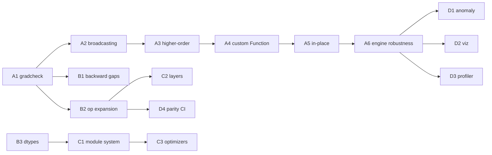

# PyTorch / libtorch Parity Roadmap

Status: **draft** · Branch: `parity/pytorch-roadmap` · Last updated: 2026-10-29

This is a staged plan to move `dart_pytorch` from a hand-curated ~1 % slice of
PyTorch toward a general-purpose differentiable tensor library. It is scoped
across four tracks:

- **A. Autograd engine** — higher-order grad, custom `Function`, in-place
  tracking, full broadcasting, `gradcheck`.
- **B. Op / kernel coverage** — close the differentiable op surface, GPU
  backward parity, dtypes.
- **C. nn.Module / training API** — layer, optimizer, scheduler, and
  serialization ergonomics.
- **D. Ecosystem / tooling** — profiler, graph viz, anomaly detection.

Full libtorch parity is explicitly **not** the goal — the target is "a faithful
and general autograd core plus the op/layer surface real models need," not
2000+ ATen ops. Each phase is independently shippable and gated by tests.

---

## Where we are today (baseline)

Grounded in the current `lib/core/tensor` implementation:

| Capability | Today |
| --- | --- |
| Reverse-mode tape | ✅ define-by-run, `_setBackward(children, fn)`, reverse-topo `backward()` |
| Leaf semantics | ✅ `requiresGrad`, `.grad`, `zeroGrad()`, `detach()`, `noGrad()` |
| Grad accumulation | ✅ `_accumulateGrad` + `_reduceForBroadcast` |
| CPU/GPU parity | ✅ backward composed from forward ops; FFI CUDA kernels |
| Op surface | ⚠️ ~25 ops (`+ - * /`, matmul, `relu/sigmoid/tanh/abs/log/pow`, `transpose/reshape`, `sum/mean`, softmax, LayerNorm, RMSNorm, crossEntropy, embedding, attention, concat, dropout, scatter, AFT) |
| Higher-order grad | 🟡 `Tensor.grads(outputs, inputs, createGraph:)` lands 2nd+ order on CPU |
| Broadcasting | 🟡 full NumPy broadcasting on CPU (fwd + backward reduce); GPU still scalar/row only |
| In-place autograd | 🟡 version counter + guard; `add_`/`mul_`/`zero_` landed |
| Custom autograd API | 🟡 `AutogradFunction` / `AutogradContext` (single-output) landed |
| `relu`/`abs` backward | ⚠️ CPU-only |
| conv / hopfield | ⚠️ bypass the tape |
| gradcheck / tooling | 🟡 CPU gradcheck + hooks + anomaly detection landed; GPU pending |

Test coverage already includes `test/autograd_test.dart` plus ~100 model/op
tests — a strong regression net to build on.

---

## Track A — Autograd engine parity

### A1. Numerical `gradcheck` harness  _(foundation — do first)_  🟡 in progress
- ✅ Added `test/gradcheck.dart`: central finite-difference vs analytic `.grad`
  with `gradCheck` / `expectGradCheck`, per-input tolerance.
- ✅ `test/gradcheck_test.dart` covers the CPU op surface (binary, unary,
  reshape/transpose, sum/mean, matmul, softmax, layerNorm, rmsNorm,
  crossEntropy, embedding, concat) — 23 ops passing.
- ⬜ Parametrize the same checks on GPU (`Device.GPU`) behind a CUDA guard.
- ⬜ Add remaining ops as they land (dropout eval-mode, scatter, AFT).
- **Exit:** all current ops pass gradcheck within tolerance on CPU **and** GPU;
  becomes the gate for every new op in Track B.

### A2. Full broadcasting in autograd  🟡 CPU done
- ✅ Generalized `_reduceForBroadcast` to full NumPy/PyTorch rules (sum out
  every expanded axis, incl. missing leading dims).
- ✅ `_binaryCpu` now broadcasts arbitrary rank operands via strides;
  shared helpers `_broadcastShapes` / `_padShape` / `_rowMajorStrides`.
- ✅ gradcheck covers row, column, leading-dim, and 3D×2D broadcasts.
- ⬜ GPU broadcast kernels (currently scalar + row-broadcast on `+` only);
  until then non-trivial GPU broadcasts throw a clear error.
- **Exit:** `a + b` etc. match `torch` broadcasting on a shape matrix;
  gradcheck passes for broadcasted operands (CPU ✅, GPU pending).

### A3. Higher-order gradients  🟡 CPU done
- ✅ `Tensor.grads(outputs, inputs, {gradOutputs, createGraph})` — functional,
  `torch.autograd.grad`-style; stashes/restores public `.grad`, retains the
  forward graph, seeds with ones by default.
- ✅ `createGraph: true` makes returned grads differentiable; second
  derivatives of `x²`, `x³`, `tanh` verified in
  `test/higher_order_grad_test.dart`.
- ⬜ GPU second-order (needs CUDA host) and a `backward(createGraph:)`
  convenience wrapper.
- **Exit:** second-order gradcheck passes for a core subset — CPU ✅
  (`*`, `pow`, `sum`, `tanh`); GPU pending.

### A4. Custom autograd `Function` API  🟡 CPU done
- ✅ `AutogradFunction` (override `forward`/`backward`) + `AutogradContext`
  (`saveForBackward`, `setData`/`getData`), spliced in via `apply` as one
  opaque tape node; forward runs detached so backward is authoritative.
- ✅ Dogfood + gradcheck in `test/autograd_function_test.dart`: `MulAdd`
  (multi-input + broadcasting), a custom `ReLU` matching the built-in, and
  a `Cube` that supports higher-order via `createGraph`.
- ⬜ Multi-output functions (currently throws `UnsupportedError`).
- **Exit:** user-defined op participates in `backward()`/`grads()` and passes
  gradcheck — ✅ (single output).

### A5. In-place op tracking  🟡 CPU done
- ✅ Per-tensor `_version` counter, bumped by `assign` and the new in-place
  ops `add_` / `mul_` / `zero_`.
- ✅ Value-dependent ops (`*`, `/`, `pow`, `matmul`) snapshot saved input
  versions via `_setBackward(..., saved:)`; the backward/`grads` walks call
  `_checkSaved()` and throw a clear “In-place operation detected” error.
- ✅ `test/inplace_autograd_test.dart`: correct values, guard fires for
  unsafe mutation (incl. via `grads`), and no false-positive for ops whose
  backward ignores values (`+`).
- ⬜ Retrofit remaining value-reading ops (softmax, layerNorm, rmsNorm,
  crossEntropy, embedding, attention, aft) with `saved:`.
- **Exit:** in-place misuse raises a clear error; valid in-place passes
  gradcheck — ✅ (CPU).

### A6. Engine robustness  🟡 CPU done
- ✅ Replaced recursive `visit()` with an iterative worklist
  (`_topoOrder`); a 20k-deep chain backprops without stack overflow.
- ✅ Shared `_runNode` drives both `backward` and `grads`:
  version-check → hooks → anomaly check → closure.
- ✅ `registerHook` / `removeHook` (observe or replace a gradient) and
  `Tensor.detectAnomaly` (NaN/Inf origin) — `test/engine_robustness_test.dart`.
- ⬜ Engine parallelism (PyTorch's multithreaded C++ engine) — out of scope.
- **Exit:** 10k-node chain backprops without overflow ✅; hook fires ✅.

---

## Track B — Op / kernel coverage parity

### B1. Close CPU/GPU backward gaps
- Port `relu` / `abs` backward to GPU (currently CPU-only).
- Wire conv1d/conv2d/conv-transpose and hopfield into the tape (or document
  as intentionally detached + provide a differentiable path).
- **Exit:** no op silently drops gradients; gradcheck on GPU for the full set.

### B2. Core math op expansion  🟡 unary done (CPU)
- ✅ Unary primitives (CPU, explicit backward): `exp`, `sqrt`, `sin`, `cos`,
  `erf`, `clamp` — each gradchecked in `test/unary_ops_test.dart`.
- ✅ Composed helpers (autograd automatic): `neg`, `reciprocal`, `rsqrt`,
  `silu`, `softplus`, `geluTanh`, `gelu` (exact) — gradchecked.
- ⬜ Reductions: `sum(axis, keepDim)`, `mean(axis)`, `max/min(axis)`,
  `var/std`, `prod`, `logsumexp`.
- ⬜ Shape: `permute`, `view`/`flatten`, `squeeze`/`unsqueeze`, `cat(axis)`,
  `stack`, `split`, `slice`/`narrow`, `gather`, `index_select`.
- ⬜ GPU kernels for the new unary ops (currently throw `UnsupportedError`).
- **Exit:** each lands with a gradcheck test (A1 gate) and GPU kernel or
  documented CPU fallback.

### B3. Dtype breadth
- Promote fp16 from "read-only for autograd" to trainable (fp32 master,
  fp16 storage) — groundwork for mixed precision.
- Add bf16 storage; integer tensors for indexing ops.
- **Exit:** a small model trains in mixed precision and matches fp32 within
  tolerance.

### B4. Linear-algebra & fused kernels
- `bmm`/batched matmul with autograd, `einsum` (subset), fused SDPA backward.
- **Exit:** batched attention path uses batched kernels; gradcheck passes.

---

## Track C — nn.Module / training API parity

### C1. Module system ergonomics
- Formalize `parameters()` / `namedParameters()` / `buffers()`,
  `state_dict()` / `load_state_dict()` on top of existing `Checkpoint`.
- `apply()`, `to(device/dtype)`, `train()/eval()` already partly present —
  unify across all modules.
- **Exit:** round-trip `state_dict` for every bundled model; device/dtype
  move is uniform.

### C2. Layer coverage
- Fill gaps vs `torch.nn`: `Conv2d`/`ConvTranspose` as first-class
  autograd modules, `BatchNorm`/`GroupNorm`, `MaxPool/AvgPool`,
  `GELU/SiLU` modules, `GRU/LSTM` (an `LSTMCell` already exists).
- **Exit:** a small CNN + an RNN train end-to-end via the tape.

### C3. Optimizers & schedulers
- Add `AdamW`, `RMSprop`, `Adagrad` alongside `SGD`/`Adam`; param groups with
  per-group lr/weight-decay.
- Schedulers: `CosineAnnealing`, `OneCycle`, `ReduceLROnPlateau` (have
  `StepLR`, `LinearWarmupCosineDecay`).
- **Exit:** param-group config drives different lr per layer; schedulers unit
  tested.

### C4. Losses & functional API
- `nn.functional`-style free functions (`mse_loss`, `nll_loss`, `bce`,
  `kl_div`, `cross_entropy` with weight/ignore_index).
- **Exit:** each loss gradchecks and has a parity test against known values.

---

## Track D — Ecosystem / tooling parity

### D1. Autograd anomaly detection
- NaN/Inf detection with the op that produced it (builds on A6 hooks).

### D2. Graph export / visualization
- `toDot()` graph dump (torchviz-style) for debugging the tape.

### D3. Lightweight profiler
- Per-op forward/backward timing + device, CPU and CUDA, aggregated report.

### D4. Benchmarks & parity CI
- Golden numerical parity tests against exported PyTorch reference tensors for
  a fixed op/model set; track drift in CI.

---

## Suggested sequencing

**Milestone 1 (unblock everything):** A1 + A2 + B1 — a trustworthy,
broadcasting, gap-free autograd with a gradcheck gate.

**Milestone 2 (differentiable-programming core):** A3 + A4 + B2 — higher-order
grad, a public custom-op API, and a real op surface.

**Milestone 3 (training parity):** A5 + A6 + C1–C4 + B3 — in-place safety, a
robust engine, and a PyTorch-shaped nn/optim/loss layer with mixed precision.

**Milestone 4 (ecosystem):** D1–D4 — tooling and CI-enforced numerical parity.

---

## Non-goals

- Matching ATen's full ~2000-op surface or complex-number support.
- CUDA-graph capture, TorchScript/compile, distributed autograd (DDP already
  has a separate path in this repo).
- Mobile/ONNX export.
